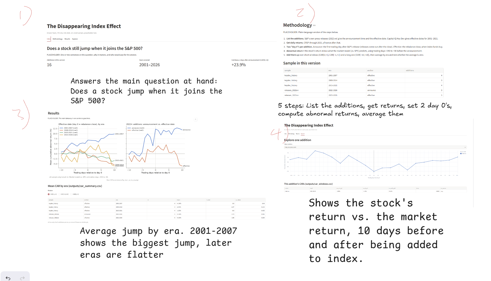

# The Disappearing Index Effect
Dream Team: Karthik Sekhar, Daniel Outkou, Manuel Casanova Jr, Tom Sickert

## Dashboard mockup

Live site: https://dream-team-index-effect.streamlit.app/

#Finished dashboard
#Intro: Answers the main question at hand: Does a stock jump when it joins the S&P 500?
#Methodology: 5 steps: List the additions, get returns, set 2 day 0's, compute abnormal returns, avg them
#Results: Shows average jump by era
#Explore: Shows the stock's return vs the market reutrn, 10 days before and after being added to S&P 500
